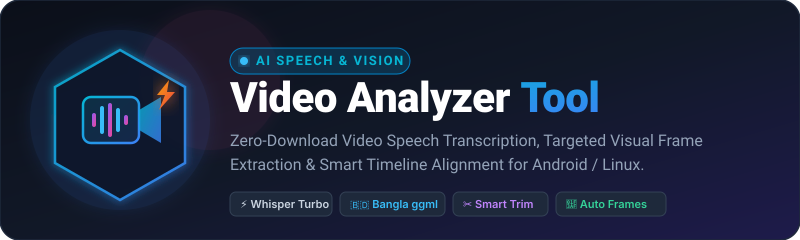
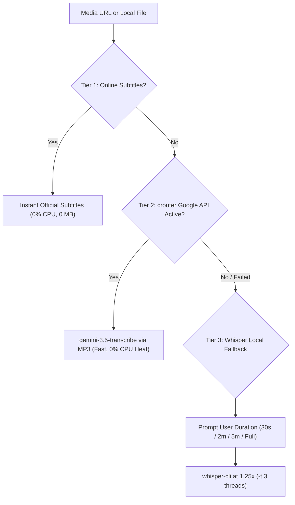

<div align="center">



<p align="center">
  <b>Zero-Download AI Video Intelligence, Speech Transcription & Visual Frame Extraction</b>
</p>

[](https://github.com/myfunuiai-del/video-analyzer-tool)
[](https://github.com/myfunuiai-del/video-analyzer-tool)
[](https://github.com/ggerganov/whisper.cpp)
[](https://github.com/myfunuiai-del/video-analyzer-tool)

</div>

---

<div align="right">

**🌐 Language / ভাষা:** &nbsp; **English** &nbsp;|&nbsp; **[🇧🇩 বাংলা সংস্করণ (README_BN.md)](./README_BN.md)**

</div>

---

## 📖 Overview

**Video Analyzer Tool** is a high-speed, zero-heat AI video intelligence and speech analysis CLI tool. Designed specifically for mobile (Termux/Android) and desktop environments, it operates without downloading multi-gigabyte video files by directly tapping into remote media streams (Facebook Reels/Videos, YouTube Shorts/Videos, X, and direct media URLs) or local media files. 

It provides seamless 3-tier speech transcription (Subtitles -> Cloud Google API -> Local Whisper Fallback), automatic visual frame extraction, and structured project caching.

---

## 🌟 Key Features

* 🚀 **Zero Full Video Download**: Analyze online video streams directly via `yt-dlp` and `ffmpeg` without storing heavy video files locally.
* ☁️ **0% CPU Heat with Google API**: Leverages `crouter` Google Studio API (`gemini-3.5-transcribe` / `gemini-3.8-flash`) with compressed MP3 chunks for instant, phone-cool transcription.
* 🤖 **Dual-Agent Architecture (AntiGem & Claude)**:
  - **In AntiGem:** Intelligently bypasses CLI execution for YouTube (handled natively) while processing Facebook, X, and local media with zero overhead.
  - **In Claude Code / SDK-CLI:** Fully powers end-to-end multi-platform video understanding including YouTube.
* 🛡️ **Interactive Whisper Fallback**: If Google API is disabled or inactive, exits with confirmation prompt (`code 2`) allowing users to choose transcription duration (`First 30s`, `2m`, `5m`, or `Full`) to prevent mobile overheating.
* ✂️ **Smart Silence Trimming with Boundary Padding**: Cuts dead silence while retaining natural 80ms boundaries to prevent clipped syllables.
* ⏱️ **Automatic Timeline Remapping**: Subtitles and extracted snapshot frames are mapped back cleanly to the source video's original timeline.
* 🎯 **Targeted Visual Frame Capture**: Scans transcripts for keywords (`github`, `repo`, `tool`, `code`, `link`, `screen`) and captures HD frames with token-refresh safeguards.
* 🧹 **Consolidated Project Cache Cleanup**: All temporary WAV files, audio chunks, and snapshot images are neatly moved into `delete/<project_name>_<id>/` with clickable cleanup links.
* 🌐 **Multilingual & Mixed-Language Support**: Seamlessly recognizes Bengali, English, and mixed conversational Banglish.

---

## 🧠 Smart 3-Tier Transcription Pipeline



---

## 🧠 Whisper Models Guide (Speed & Bengali Accuracy)

When local fallback is required, `whisper.cpp` quantized models provide offline transcription:

| Model Name | File Name | Size | Recommended Use Case | Speed Rating |
| :--- | :--- | :--- | :--- | :--- |
| **Bengali Medium (Fine-Tuned)** ⭐ | `ggml-bn-medium-q5_0.bin` | ~539 MB | **Best for Pure Bengali audio.** Exceptionally accurate pronunciation and grammar handling. | ⚡⚡⚡ (Balanced) |
| **Large v3 Turbo (Fast & Accurate)** ⚡ | `ggml-large-v3-turbo-q5_0.bin` | ~574 MB | **Fastest & Most Accurate.** Top choice for English, mixed Banglish, and general speech. | ⚡⚡⚡⚡⚡ (Ultra Fast) |
| **Base Model (Lightweight)** 🪶 | `ggml-base.bin` | ~148 MB | **Fast language identification** and lightweight transcription on low-RAM devices. | ⚡⚡⚡⚡ (Very Fast) |
| **Small Model (General)** | `ggml-small.bin` | ~487 MB | Balanced trade-off between speed and accuracy. | ⚡⚡⚡ (Good) |

> 💡 **Default Models Directory:** `$HOME/tools/whisper.cpp/models/`

---

## 🛠️ Installation

```bash
# Clone the repository
git clone https://github.com/myfunuiai-del/video-analyzer-tool.git
cd video-analyzer-tool

# Run setup script
chmod +x install.sh
./install.sh
```

---

## 💻 Usage & CLI Examples

```bash
# Facebook Reels or Videos:
video-analyzer "https://www.facebook.com/share/v/1DUg7LdCX4/"

# YouTube Shorts or Full Videos:
video-analyzer "https://youtube.com/shorts/vmD2IHFSutY"

# Force Run on AntiGem (bypassing native YouTube prompt):
video-analyzer "https://youtube.com/watch?v=..." --force

# Allow Local Whisper Fallback without interactive prompt:
video-analyzer "/sdcard/Download/my_video.mp4" --allow-whisper --max-duration 120

# Custom Output Directory:
video-analyzer "https://www.facebook.com/share/..." -o "$HOME/.antigem/media_analysis"
```

---

## 📂 Output Structure & Cache

Each run creates a dedicated, self-contained project directory under `delete/` for easy review and one-tap cleanup:

```text
~/.antigem/media_analysis/delete/<project_title>_<hash>/
├── analysis_manifest.json          # Complete JSON metadata, timeline maps, and frame info
├── transcript_clean.txt            # Deduplicated clean readable text
├── google_transcribe.srt           # Full SRT subtitles synchronized with original timeline
├── frame_1_0s_direct.jpg          # Captured targeted visual frame snapshots
└── audio_16k_mono.wav              # Retained audio chunk (if applicable)
```

---

## 🤝 Contribution & License

Open for personal and open-source contributions. Distributed under the MIT License.
