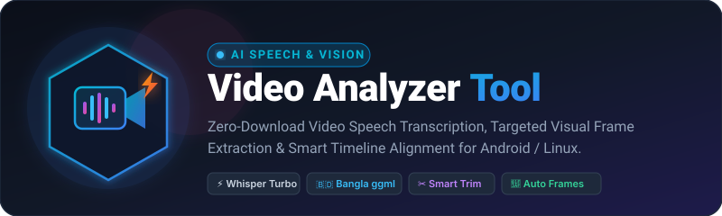

<div align="center">



<p align="center">
  <b>জিরো-ডাউনলোড এআই ভিডিও অ্যানালাইসিস, স্পিচ ট্রান্সক্রিপশন ও ভিজ্যুয়াল ফ্রেম ক্যাপচার</b>
</p>

[](https://github.com/myfunuiai-del/video-analyzer-tool)
[](https://github.com/myfunuiai-del/video-analyzer-tool)
[](https://github.com/ggerganov/whisper.cpp)
[](https://github.com/myfunuiai-del/video-analyzer-tool)

</div>

---

<div align="right">

**🌐 Language / ভাষা:** &nbsp; **[🇬🇧 English (README.md)](./README.md)** &nbsp;|&nbsp; **বাংলা**

</div>

---

## 📖 পরিচিতি (Overview)

**Video Analyzer Tool** হলো একটি দ্রুতগতির ও রিসোর্স-অপ্টিমাইজড এআই ভিডিও বিশ্লেষণ টুল। এটি পুরো ভিডিও ডাউনলোড না করেই রিমোট স্ট্রিমিং লিঙ্ক (Facebook Reel/Watch, YouTube Shorts/Video, X/Direct Video) কিংবা লোকাল ভিডিও ফাইল থেকে অত্যন্ত দ্রুত গতিতে স্পিচ টু টেক্সট (অডিও ট্রান্সক্রিপশন), সাইলেন্স ট্রিম, টাইমস্ট্যাম্প রিম্যাপিং এবং গুরুত্বপূর্ণ ভিজ্যুয়াল ফ্রেম স্বয়ংক্রিয়ভাবে ক্যাপচার করে।

---

## 🌟 মূল সুবিধাসমূহ (Key Features)

* 🚀 **Zero-Download Streaming**: মাল্টি-গিগাবাইট ভিডিও ডাউনলোড করার দরকার নেই; `yt-dlp` ও `ffmpeg` দিয়ে রিমোট স্ট্রিম থেকে সরাসরি অডিও/ভিডিও অ্যানালাইসিস করে।
* ✂️ **Smart Silence Trimming with Boundary Padding**: কথার মাঝের অতিরিক্ত নীরবতা স্বয়ংক্রিয়ভাবে বাদ দিয়ে প্রসেসিং টাইম কমায় এবং ৮০ms প্যাডিং নিশ্চিত করে কোনো শব্দ যাতে না কাটে।
* ⏱️ **Automatic Timeline Remapping**: ট্রিম হওয়া অডিওর সাবটাইটেল এবং স্ক্রিনশট ফ্রেমের সময় স্বয়ংক্রিয়ভাবে মূল ভিডিওর আসল টাইমলাইনের সাথে নিখুঁতভাবে সমন্বয় (remap) হয়ে যায়।
* 🛡️ **Anti-Overheating Speed Probing**: ১৫–৩০ মিনিটের লম্বা ভিডিওর জন্য বারবার পুরো ফাইল ট্রান্সক্রাইব না করে ৬০ সেকেন্ডের ছোট স্যাম্পল টেস্ট করে দ্রুততম ও সেরা অ্যাকুরেট স্পিড বেছে নেয়।
* 🎯 **Targeted Visual Frame Capture**: ট্রান্সক্রিপ্টে উল্লেখিত গুরুত্বপূর্ণ কি-ওয়ার্ড (যেমন: GitHub repo, link, tool, code, website) শনাক্ত করে সেই মুহূর্তের এইচডি ফ্রেম সংরক্ষণ করে।
* 🌐 **বহুভাষিক সমর্থন (Multilingual Support)**: খাঁটি বাংলা, ইংরেজি ও বাংলিশ মিশ্রিত কথ্য ভাষা নিখুঁতভাবে শনাক্ত ও ট্রান্সক্রাইব করতে সক্ষম।

---

## 🧠 Whisper মডেল গাইড (Bengali & Fast Models)

ভিডিও অ্যানালাইজার স্ক্রিপ্টটি `whisper.cpp` এর কোয়ান্টাইজড মডেলের সাহায্যে কাজ করে:

| মডেলের নাম | ফাইলের নাম | সাইজ | কার্যকারিতা ও কোন ক্ষেত্রে সেরা | স্পিড রেটিং |
| :--- | :--- | :--- | :--- | :--- |
| **Bengali Medium (Fine-Tuned)** ⭐ | `ggml-bn-medium-q5_0.bin` | ~539 MB | **খাঁটি বাংলা (Pure Bengali) ভাষার জন্য সেরা।** উচ্চারণ ও ব্যাকরণ অত্যন্ত নিখুঁতভাবে ধরতে পারে। | ⚡⚡⚡ (সুষম) |
| **Large v3 Turbo (Fast & Accurate)** ⚡ | `ggml-large-v3-turbo-q5_0.bin` | ~574 MB | **সবচেয়ে দ্রুত ও অ্যাকুরেট।** ইংরেজি, মিশ্র ভাষা (Banglish) এবং সাধারণ স্পিচের জন্য প্রথম পছন্দ। | ⚡⚡⚡⚡⚡ (চরম দ্রুত) |
| **Base Model (Lightweight)** 🪶 | `ggml-base.bin` | ~148 MB | **দ্রুত ভাষা শনাক্তকরণ (Language Detection)** ও অল্প র‍্যামের ফোনে সুপারফাস্ট ট্রান্সক্রিপশন। | ⚡⚡⚡⚡ (খুব দ্রুত) |
| **Small Model (General)** | `ggml-small.bin` | ~487 MB | মিডিয়াম ও বেসের মাঝামাঝি সাধারণ ব্যালান্সড পারফরম্যান্স। | ⚡⚡⚡ (ভালো) |

> 💡 **মডেল ডিরেক্টরি পাথ:** `$HOME/tools/whisper.cpp/models/`

### মডেল ডাউনলোড কমান্ড:
```bash
mkdir -p "$HOME/tools/whisper.cpp/models" && cd "$HOME/tools/whisper.cpp/models"

# লার্জ ভি৩ টার্বো মডেল
curl -L -O https://huggingface.co/ggerganov/whisper.cpp/resolve/main/ggml-large-v3-turbo-q5_0.bin

# বেস মডেল (ল্যাঙ্গুয়েজ ডিটেকশন)
curl -L -O https://huggingface.co/ggerganov/whisper.cpp/resolve/main/ggml-base.bin
```

---

## 🛠️ ইনস্টলেশন (Installation)

```bash
# রিপোজিটরি ক্লোন করুন
git clone https://github.com/myfunuiai-del/video-analyzer-tool.git
cd video-analyzer-tool

# সেটআপ স্ক্রিপ্ট চালান
chmod +x install.sh
./install.sh
```

---

## 💻 ব্যবহার বিধি (Usage Examples)

```bash
# ফেসবুক ভিডিও বা রিল:
video-analyzer "https://www.facebook.com/share/v/1DUg7LdCX4/"

# ইউটিউব শর্টস বা ভিডিও:
video-analyzer "https://youtube.com/shorts/vmD2IHFSutY"

# লোকাল ভিডিও ফাইল:
video-analyzer "/sdcard/Download/my_video.mp4"

# নিজস্ব আউটপুট ফোল্ডার নির্ধারণ:
video-analyzer "https://youtube.com/watch?v=..." -o "./custom_output"
```

---

## 📂 আউটপুট রেজাল্ট ডিরেক্টরি (Output Structure)

প্রতিটি অ্যানালাইসিসের পর একটি স্বতন্ত্র রান ডিরেক্টরি তৈরি হয়:

```text
~/.antigem/media_analysis/<run_hash>_<timestamp>/
├── analysis_manifest.json            # সম্পূর্ণ টেকনিক্যাল মেটাডাটা, ড্রিফট স্কোর ও সামারি
├── transcript_clean.txt              # পুনরাবৃত্তি ছাড়া ফ্রেশ রিডেবল টেক্সট
├── whisper_sub_original_timeline.srt   # আসল ভিডিওর সাথে হুবহু সিঙ্ক করা SRT সাবটাইটেল
├── audio_1p25x_16k_mono.wav          # ট্রিম করা অপ্টিমাইজড অডিও
└── frames/                           # স্বয়ংক্রিয়ভাবে ক্যাপচার করা স্ক্রিনশটসমূহ
    ├── frame_1_15s_direct.jpg
    └── frame_2_82s_segment.jpg
```

---

## 🤝 লাইসেন্স ও অবদান (License)

ব্যক্তিগত ও ওপেন-সোর্স ব্যবহারের জন্য উন্মুক্ত। MIT License এর আওতাভুক্ত।
