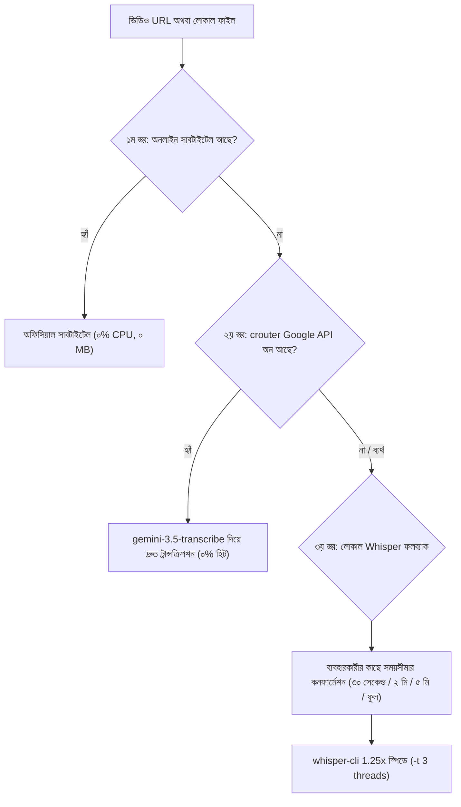

<div align="center">


<p align="center">
  <b>জিরো-ডাউনলোড এআই ভিডিও অ্যানালাইসিস, স্পিচ ট্রান্সক্রিপশন ও ভিজ্যুয়াল ফ্রেম ক্যাপচার</b>
</p>

[](https://github.com/myfunuiai-del/video-analyzer-tool)
[](https://github.com/myfunuiai-del/video-analyzer-tool)
[](https://github.com/ggerganov/whisper.cpp)
[](https://github.com/myfunuiai-del/video-analyzer-tool)

</div>

---

<div align="right">

**🌐 Language / ভাষা:** &nbsp; **[🇬🇧 English (README.md)](./README.md)** &nbsp;|&nbsp; **বাংলা**

</div>

---

## 📖 পরিচিতি (Overview)

**Video Analyzer Tool** হলো মোবাইল (Termux/Android) ও ডেস্কটপ উভয়ের জন্য একটি উচ্চগতির, রিসোর্স-অপ্টিমাইজড ও শূন্য-তাপমাত্রার (Zero-Heat) এআই ভিডিও বিশ্লেষণ সিএলআই টুল। 

এটি পুরো ভিডিও ডাউনলোড না করেই রিমোট স্ট্রিমিং লিঙ্ক (Facebook Reel/Watch, YouTube Shorts/Video, X/Twitter, ডিরেক্ট লিঙ্ক) কিংবা লোকাল ভিডিও ফাইল থেকে ৩-স্তরীয় ট্রান্সক্রিপশন পাইপলাইন (সাবটাইটেল -> ক্লাউড গুগল এপিআই -> লোকাল হুইস্পার ফলব্যাক), সাইলেন্স ট্রিম, টাইমস্ট্যাম্প রিম্যাপিং এবং গুরুত্বপূর্ণ ভিজ্যুয়াল ফ্রেম স্বয়ংক্রিয়ভাবে ক্যাপচার করে।

---

## 🌟 মূল সুবিধাসমূহ (Key Features)

* 🚀 **Zero-Download Streaming**: মাল্টি-গিগাবাইট ভিডিও ডাউনলোড করার প্রয়োজন নেই; `yt-dlp` ও `ffmpeg` দিয়ে রিমোট স্ট্রিম থেকে সরাসরি অডিও/ভিডিও অ্যানালাইসিস করে।
* ☁️ **Google API দিয়ে ০% ফোন হিটিং**: `crouter`-এ সেট করা Google Studio API (`gemini-3.5-transcribe` / `gemini-3.8-flash`) এবং হালকা MP3 চাঙ্ক ব্যবহারের ফলে ফোন গরম না করে মাত্র কয়েক সেকেন্ডে সুপারফাস্ট ট্রান্সক্রিপশন সম্পন্ন হয়।
* 🤖 **ডুয়াল এজেন্ট আর্কিটেকচার (AntiGem ও Claude)**:
  - **AntiGem এ:** YouTube লিঙ্কের ক্ষেত্রে অতিরিক্ত টার্মিনাল রান এড়িয়ে নেটিভ সামারি ব্যবহার করে এবং Facebook, X ও লোকাল ফাইল অপ্টিমাইজড পাইপলাইনে প্রসেস করে।
  - **Claude Code / SDK-CLI এ:** YouTube সহ যেকোনো ভিডিও প্ল্যাটফর্মের ফুল অডিও ও ফ্রেম প্রসেসিং নিশ্চিত করে।
* 🛡️ **স্মার্ট হুইস্পার ফলব্যাক ও ইউজার কনফার্মেশন**: Google API অফ বা ব্যর্থ হলে ফোন ওভারহিটিং রোধ করতে অডিও দৈর্ঘ্য প্রদর্শনের মাধ্যমে ব্যবহারকারীকে সময়সীমা নির্ধারণ করার সুযোগ দেয় (`code 2`)।
* ✂️ **Smart Silence Trimming with Boundary Padding**: কথার মাঝের অতিরিক্ত নীরবতা স্বয়ংক্রিয়ভাবে বাদ দিয়ে প্রসেসিং টাইম কমায় এবং ৮০ms প্যাডিং নিশ্চিত করে কোনো শব্দ যাতে না কাটে।
* ⏱️ **Automatic Timeline Remapping**: ট্রিম হওয়া অডিওর সাবটাইটেল এবং স্ক্রিনশট ফ্রেমের সময় স্বয়ংক্রিয়ভাবে মূল ভিডিওর আসল টাইমলাইনের সাথে নিখুঁতভাবে সমন্বয় (remap) হয়ে যায়।
* 🎯 **Targeted Visual Frame Capture**: ট্রান্সক্রিপ্টে উল্লেখিত গুরুত্বপূর্ণ কি-ওয়ার্ড (যেমন: GitHub repo, link, tool, code, website) শনাক্ত করে সেই মুহূর্তের এইচডি ফ্রেম সংরক্ষণ করে।
* 🧹 **এক ক্লিকে প্রজেক্ট ক্যাশ ক্লিনআপ**: সব ধরনের ইন্টারমিডিয়েট অডিও, ক্লিপ ও স্ক্রিনশট `delete/<project_name>_<id>/` ফোল্ডারে সুসজ্জিত থাকে, ফলে এক ক্লিকেই স্টোরেজ খালি করা যায়।
* 🌐 **বহুভাষিক সমর্থন (Multilingual Support)**: খাঁটি বাংলা, ইংরেজি ও বাংলিশ মিশ্রিত কথ্য ভাষা নিখুঁতভাবে শনাক্ত ও ট্রান্সক্রাইব করতে সক্ষম।

---

## 🧠 স্মার্ট ৩-স্তরীয় ট্রান্সক্রিপশন পাইপলাইন (3-Tier Pipeline)



---

## 🧠 Whisper মডেল গাইড (Bengali & Fast Models)

লোকাল হুইস্পার ফলব্যাকের ক্ষেত্রে `whisper.cpp` এর কোয়ান্টাইজড মডেলগুলো ব্যবহৃত হয়:

| মডেলের নাম | ফাইলের নাম | সাইজ | কার্যকারিতা ও কোন ক্ষেত্রে সেরা | স্পিড রেটিং |
| :--- | :--- | :--- | :--- | :--- |
| **Bengali Medium (Fine-Tuned)** ⭐ | `ggml-bn-medium-q5_0.bin` | ~539 MB | **খাঁটি বাংলা (Pure Bengali) ভাষার জন্য সেরা।** উচ্চারণ ও ব্যাকরণ অত্যন্ত নিখুঁতভাবে ধরতে পারে। | ⚡⚡⚡ (সুষম) |
| **Large v3 Turbo (Fast & Accurate)** ⚡ | `ggml-large-v3-turbo-q5_0.bin` | ~574 MB | **সবচেয়ে দ্রুত ও অ্যাকুরেট।** ইংরেজি, মিশ্র ভাষা (Banglish) এবং সাধারণ স্পিচের জন্য প্রথম পছন্দ। | ⚡⚡⚡⚡⚡ (চরম দ্রুত) |
| **Base Model (Lightweight)** 🪶 | `ggml-base.bin` | ~148 MB | **দ্রুত ভাষা শনাক্তকরণ (Language Detection)** ও অল্প র‍্যামের ফোনে সুপারফাস্ট ট্রান্সক্রিপশন। | ⚡⚡⚡⚡ (খুব দ্রুত) |
| **Small Model (General)** | `ggml-small.bin` | ~487 MB | মিডিয়াম ও বেসের মাঝামাঝি সাধারণ ব্যালান্সড পারফরম্যান্স। | ⚡⚡⚡ (ভালো) |

> 💡 **মডেল ডিরেক্টরি পাথ:** `$HOME/tools/whisper.cpp/models/`

---

## 🛠️ ইনস্টলেশন (Installation)

```bash
# রিপোজিটরি ক্লোন করুন
git clone https://github.com/myfunuiai-del/video-analyzer-tool.git
cd video-analyzer-tool

# সেটআপ স্ক্রিপ্ট চালান
chmod +x install.sh
./install.sh
```

---

## 💻 ব্যবহার বিধি (Usage Examples)

```bash
# ফেসবুক ভিডিও বা রিল:
video-analyzer "https://www.facebook.com/share/v/1DUg7LdCX4/"

# ইউটিউব শর্টস বা ভিডিও:
video-analyzer "https://youtube.com/shorts/vmD2IHFSutY"

# AntiGem-এ জোরপূর্বক ভিডিও-অ্যানালাইজার চালাতে চাইলে:
video-analyzer "https://youtube.com/watch?v=..." --force

# প্রম্পট ছাড়া লোকাল হুইস্পার ফলব্যাক অনুমোদন করতে:
video-analyzer "/sdcard/Download/my_video.mp4" --allow-whisper --max-duration 120

# নিজস্ব আউটপুট ফোল্ডার নির্ধারণ:
video-analyzer "https://www.facebook.com/share/..." -o "$HOME/.antigem/media_analysis"
```

---

## 📂 আউটপুট রেজাল্ট ডিরেক্টরি (Output Structure & Cache)

প্রতিটি অ্যানালাইসিসের পর সমস্ত ফাইল `delete/` ডিরেক্টরির অধীনে একটি নির্দিষ্ট প্রজেক্ট ফোল্ডারে সেভ হয়:

```text
~/.antigem/media_analysis/delete/<project_title>_<hash>/
├── analysis_manifest.json          # সম্পূর্ণ টেকনিক্যাল মেটাডাটা, ড্রিফট স্কোর ও সামারি
├── transcript_clean.txt            # পুনরাবৃত্তি ছাড়া ফ্রেশ রিডেবল টেক্সট
├── google_transcribe.srt           # আসল ভিডিওর সাথে হুবহু সিঙ্ক করা SRT সাবটাইটেল
├── frame_1_0s_direct.jpg          # গুরুত্বপূর্ণ মুহূর্তের ক্যাপচার করা স্ক্রিনশট ফ্রেম
└── audio_16k_mono.wav              # প্রয়োজনীয় অডিও ফাইল
```

---

## 🤝 লাইসেন্স ও অবদান (License)

ব্যক্তিগত ও ওপেন-সোর্স ব্যবহারের জন্য উন্মুক্ত। MIT License এর আওতাভুক্ত।
